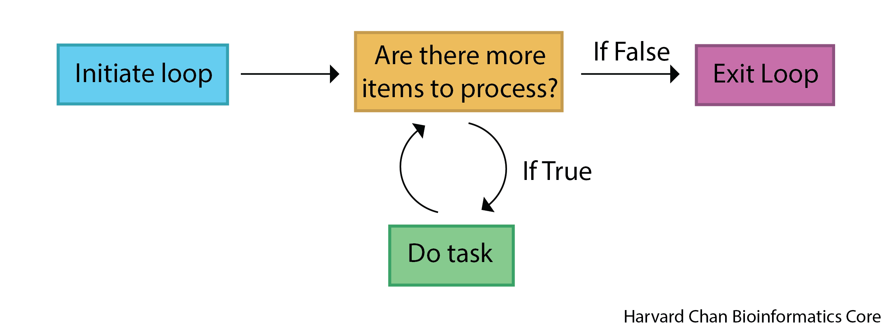

Approximate time: 25 min

## Learning Objectives

- Describe the components of a `for` loop in R
- Write a `for` loop that iterates over a vector
- Use a `for` loop to process multiple files

## Loops

One of the most common problems that programming solves is the tedium of performing the same task/calculation repeatedly. Instead of writing the same code over and over again, we can use loops for automation. This is essential in a real-world analysis, where you might need to process hundreds of files or thousands of values consistently and with less risk of human error. In this lesson, we will learn about a common loop, the `for` loop.

Importantly, due to the way R handles data, you will likely use loops much less than you would in other programming languages. Many tasks that can be accomplished with a `for` loop in R can also be performed using R's built-in vectorized functions. Other alternatives include functions from the `purrr` package, such as the `map()` family, or base R functions such as `lapply()`. Although vectorized functions, `lapply()`, and `purrr::map()` are often useful alternatives, `for` loops remain important, because they help us understand repeated operations, read existing code and perform tasks involving multiple steps.

### Basic Syntax

The logic of a `for` loop is diagrammed below:

::: {#fig-for_loop .figure}
{width=600px}

Schematic of `for` loop process.
:::

Let's see an implementation of a `for` loop in R:

```{r}
#| label: basic_for_loop
# For each number in the vector 1 to 5, assign each to sample_id
for (sample_id in 1:5){
  # Print the sample_id to the console
  print(sample_id)
}
```

In this example, `1:5` creates a vector containing the numbers 1 through 5. During each iteration, the next value in this vector is assigned to `sample_id` and the value of `sample_id` is printed to the console. For example, during the first iteration, `sample_id` is 1, then during the second iteration, `sample_id` is 2, and so on. The code inside the braces runs once for each value in the vector. The key elements of a `for` loop are:

- `for` - Needed to initiate a `for` loop
- A variable - A variable to hold the value for each iteration of the loop
- A vector - A vector to loop over
- Code to be looped over - Code that should be executed in each iteration of the loop

:::{.callout-note}
Note that the `print()` function displays an object or text in the console.
:::

:::{.callout-tip}
# [**Exercise 1**](Aside_loops-Answer_key.qmd#exercise-1)
1. Create a `for` loop that goes from 1 to 8 and prints each number appended to the end of the text "Processing sample_" to the console.

*Hint:* One function we have not discussed previously but is helpful for this is `paste0()`, which *pastes* together strings. 
:::

We can also place loops inside of other loops such as:

```{r}
#| label: loop_inside_loop
# Create a vector of samples
samples <- c("sample_1", "sample_2")
# Create a vector of genes
genes <- c("TP53", "BRCA1", "EGFR")

# For each sample in samples
for (sample in samples) {
  # For each gene in genes
  for (gene in genes) {
    # Print the sample, then gene, separated by a colon
    print(paste0(sample, ":", gene))
  }
}
```

The outer loop iterates over samples, while the inner loop iterates over
genes within each sample. Nested loops are useful when every combination of
two sets of values must be processed.

### Reading in data using a `for` loop

When analyzing data, one might have a separate data file for each sample. As a result, one common use case for using `for` loops is for reading in multiple data files rather than reading them in individually. In our `data` directory, we will see that we have two CSV files named `experiment_1.csv` and `experiment_2.csv`. We will use a `for` loop to read them in. While it might not be the most efficient use case when you only have two data files, you could imagine that this could be dozens or hundreds of data files and then the use case is more clear.

```{r}
#| label: reading_in_data_for_loops
# For each file
for (file_number in 1:2){
  # Assign the file to an object called experiment_ followed by its file_number
  assign(
    paste0("experiment_", file_number),
    read.csv(paste0("data/experiment_", file_number, ".csv"))
  )
}
```

The `assign` function is also a new function for us. It allows us to assign objects into the environment similarly to the assignment operator, `<-`. The first argument specifies the name of the object and the second argument specifies the value to assign to it. The `assign` function allows us to use dynamic naming like we are doing here, while the `<-` forces us to conform to static naming. 

One possible approach is to use `assign()` to create dynamically named objects, as we did above. **However, this is usually not recommended because it scatters related data across many objects in the environment.** A list is generally a better choice because it keeps related data together and makes it easier to process the files programmatically. For example, functions such as `lapply()` can apply an operation to every element of a list. We can instead read the data into a list like:

```{r}
#| label: for_loop_list
# Create list to hold experimental data
experimental_data <- list()

# For each file
for (file_number in 1:2){
  # Read-in the CSV and assign it to a slot in the experimental_data list
  experimental_data[[file_number]] <- read.csv(paste0("data/experiment_", file_number, ".csv"))
}
```

In this lesson, we used `for` loops to iterate over vectors, explored nested loops and read multiple files into a list. In R, vectorized functions and list-processing functions are often useful alternatives, but `for` loops remain an important tool as well.
